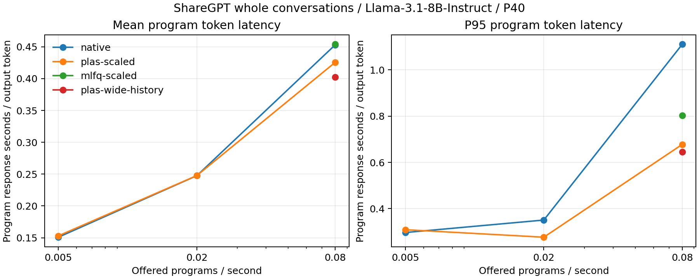

# Autellix 论文复现尝试：完整对话、调度实现与负载实验

本轮接续[上一轮源码与 GPU 核对](autellix-paper-audit.md)，重新检查源代码、输入构造、
指标和 SGLang 对照条件。依据为 [Autellix 论文 v1](https://arxiv.org/html/2502.13965v1)
的算法 1/2、实现章节与实验章节。
92 个 Python/启动脚本的路径、行数和 SHA256 见
[本轮源码清单](results/design-review-source-inventory.json)。

## 源码实现结论

程序级 PLAS、在线 ATLAS、多级 FIFO、时间片降级、防饥饿、N 步调度窗口、K 个预备
请求、KV 主机换出/恢复和程序亲和路由均有实现。SGLang 路径在实际 GPU scheduler
子进程安装钩子：更改真实 running batch、waiting queue 和 KV 所有权，再执行模型。
CPU 模拟器与真实推理路径独立。

| 源码范围 | 核对结果 |
| --- | --- |
| `autellix/runtime/policy.py` | PLAS 累计已完成调用的服务秒数；在线 ATLAS 继承程序标量并在完成时取最大值；时间片消耗使用真实模型批次耗时 |
| `runtime/window.py` | 冻结 N 步队列顺序，活动请求结束后由已准备的 reserve 补位 |
| `integrations/sglang/{scheduler,pressure,reserve,swap}.py` | 接纳、优先级抢占、显存压力处理、锁页 CPU KV 备份和恢复；保留已生成 token |
| `integrations/sglang/{legacy_gpu,attention}.py` | P40 原生算子与缓存前缀 attention；新增长 Query 分块，数值回归覆盖 FP16/FP32 |
| `runtime/{engine,client,server}.py` | 真实副本进程、会话、路由、IPC、Future、HTTP、流式响应、取消和清理 |
| `integrations/vllm/`、`runtime/swap.py` | vLLM 0.6.1 对接与多步计划，CPU mock 测试覆盖接纳和交换；本轮 GPU 实验使用 SGLang |
| `core/`、`frontend/`、`experiments/`、旧顶层兼容模块 | 离散模拟、显式 DAG、合成负载和数据导入；模拟服务时间与实测服务时间分开 |
| `runtime/benchmark.py`、`scripts/` | 实际模型回放、泊松到达、固定输入、版本/配置/哈希、按到达率配对汇总 |
| `tests/`、`examples/`、`cuda/` | 单元回归、GPU 验证、调用示例和交换微基准 |

仍待实现或扩展的论文内容：

- 专用 CUDA KV 打包内核和 SGLang 跨请求批量交换。当前 SGLang 实现按请求使用 PyTorch
  gather/stack/scatter，每次换出同步传输。
- 完整的 BFCL ReAct、LATS MCTS 和等比例 Mixed 真实工作流。当前这三类名称在
  合成模拟负载中出现；真实 GPU 数据回放目前为 ShareGPT。
- 70B/180B、多 GPU tensor parallel 以及论文的大规模多副本负载实验。当前实测
  论文同系列模型为 Llama-3.1-8B-Instruct，SGLang 每个副本使用一张 P40。
- N 步窗口内仍逐 token 计时、发布元数据和写 SQLite，尚未移除这部分控制开销。

顺序对话中 PLAS 与在线 ATLAS 的服务历史更新等价；本轮主实验使用 PLAS。
真实 ATLAS 对应算法 1 的在线程序标量，显式父节点公式版本在模拟器 `atlas-dag`。

## 实验设计中修正的问题

**1. 恢复完整程序。** ShareGPT 文件的 `id` 数字后缀是原始消息偏移。
94,145 个片段无冲突、无缺口地合并为 50,142 个完整对话。旧协议按片段建会话，
平均 3.91 次调用；恢复后为 6.648 次，接近论文报告的 6.66。
程序被切断时，累计服务历史和长短程序差异都被削弱，正好影响 PLAS 的目标。

**2. 固定正确的模型输入。** Llama chat template 已包含 BOS；旧代码对渲染后的
字符串再次默认编码，会得到重复 BOS。现在使用 `add_special_tokens=False` 编码并
存储 `input_ids`，两组直接提交相同 token。每轮输入使用参考对话历史，输出长度
保留参考回答 token 数，`ignore_eos=true`，不把生成文本反馈进下一轮。

**3. 保留长对话和原回答长度。** 默认取消 32 token 截断和 2–8 调用过滤，改为
1–80 调用、32768 上下文；超长时过滤整个对话。80 为论文报告的最大调用数，
原始恢复数据的最大值为 411，具体清洗集合仍与论文不同。

**4. 正确比较指标。** 论文主要比较同一程序延迟下能承受的程序到达率。
此前只比较短 trace 从开始到全部排空的输出 token/s，会把到达间隔、尾部排空、
模型吞吐与调度收益混在一起。本轮记录低/中/高三个泊松到达率下的程序响应和
响应秒数/输出 token，同时保留到达窗口、排空耗时和到达期间完成数。

**5. 区分适配开销与策略效果。** 增加原生 SGLang、Autellix 内部 FCFS、原时间片、
放大时间片/服务区间及 MLFQ 消融。选中请求全部能放入 KV 预算时保留已有 decode，
避免仅因前面出现 prefill 就换出；此项单独保留开关，按实测结果评价。

**6. 校准合成负载统计。** 原 `_bounded_lognormal` 将目标均值乘以
`LogNormal(0, sigma)`，实际均值被放大为目标的 `exp(sigma²/2)` 倍。
现用 `mu=-sigma²/2`，并修正 ShareGPT、BFCL、LATS 的调用数取样均值。
统计回归覆盖论文表中的均值；分布形状和模拟执行/缓存/交换成本仍是项目设定。
模拟结果现在显式带 `measurement=simulation`。本轮 GPU 对照使用真实数据，
不依赖这些合成分布或成本模型。

## 条件对照

| 项目 | 论文 | 本轮 |
| --- | --- | --- |
| 硬件 | A100 SXM4 80GB，单卡/4卡/8卡 | 3×P40 服务器，计时实验串行使用单张 P40 |
| 主要后端 | vLLM 0.6.1，另有优化基线 | SGLang 0.4.9.post6，双方共享 P40 算子 |
| 模型 | Llama-3.1-8B/70B、Falcon-180B | Llama-3.1-8B-Instruct FP16；SmolLM2-135M 用于短消融 |
| 数据 | ShareGPT、BFCL、LATS、Mixed | 恢复后的完整 ShareGPT 对话子集 |
| 程序到达 | 泊松过程 | 0.005、0.02、0.08 程序/秒，同种子同 trace |
| 缓存 | 主基线与优化基线分开 | 原生与 Autellix 均有 radix 前缀缓存 |
| 活动 batch | 对照保持一致 | B=4；Autellix 另有 K=1 预备请求，解码容量仍为 4 |
| KV/context | 依硬件配置 | 均为 32768 token；主机交换预算 8 GiB |
| 调度参数 | 文中未给出完整数值表 | N=8、beta=8；时间片和历史区间为默认值的 64 倍 |

64 倍是 P40 时间尺度消融选择，未作为论文原参数。默认最短时间片只有 0.01 秒，
当 N 步模型执行已经显著超过它时，请求很容易在每个窗口降级、抢占和恢复。
时间片与服务区间现在可独立配置，以便进一步区分两者的影响。

本轮池包含 128 个完整对话、781 次调用、221,779 个参考输出 token；从 129 个
打乱后的候选中选出。平均每程序 6.10 次调用、每调用 283.97 输出 token。
每个负载点抽取 12 个程序、66 次调用、17,679 个输出 token，最长 28 次调用，
最大输入 8,366 token。随机种子 100，每条件一轮，低负载到达窗口约 1,836 秒。
精确模型版本、数据哈希与每组配置保存在结果文件中。

服务器为 Ubuntu 22.04.5、Xeon E5-2680 v4、18 核 CPU 配额、72 GiB 内存，
3 张 P40 的算力均为 6.1。环境为 Python 3.10.12、Torch 2.7.1+cu126、
transformers 4.54.0。计时实验仅占用一张 GPU；GPU 2 上的 HTTP 服务保持空闲。
双方均关闭 overlap、chunked prefill 和 CUDA Graph，使用相同的 P40 attention。

## 短回放消融

SmolLM2-135M FP32，12 程序、48 调用、1532 输出 token，B=2、N=8、K=0，
到达率 1 程序/秒。以下每条件运行一次，全部 48 个输出文本一致。

| 条件 | 输出 token/s | 平均程序响应秒 | 相对原生吞吐 | 工作负载换出次数 |
| --- | ---: | ---: | ---: | ---: |
| 原生 SGLang | 23.484 | 32.058 | — | 0 |
| Autellix 内部 FCFS | 23.268 | 33.166 | −0.92% | 0 |
| 原时间片、旧接纳 | 20.665 | 44.890 | −12.01% | 135 |
| 原时间片、保留可容纳 decode | 20.345 | 45.940 | −13.37% | 130 |
| PLAS，时间片/历史区间 ×64 | 22.879 | 37.779 | −2.58% | 25 |
| MLFQ，时间片/历史区间 ×64 | 23.415 | 37.179 | −0.29% | 61 |

仅保留 decode 减少了 5 次换出，这一轮总耗时没有改善。放大时间尺度明显减少交换，
但短回放上的程序响应仍高于原生。FCFS 包装吞吐差距较小，说明该组主要损失来自
调度选择和抢占频率，而不是单纯接入一层 Python 封装。

队列 trace 给出了更具体的原因：原参数下 12 个首次调用进入第 0 队列，剩余
36 次调用全部进入最低优先级的第 6 队列；后续又在第 6 队列轮转降级 105 次。
程序服务历史迅速超过区间上限，无法再区分中等程序与长程序。×64 后的接纳分布
变为第 0/1/2/3/4 队列分别 12/1/15/12/8 次，换出 token 总量从 97,519 降至
7,830。时间片与区间需要随硬件执行秒数校准，这比只调换调度器名称更关键。

## 完整对话负载曲线

| 到达率 | 条件 | 平均响应秒 | 响应秒/输出 token | 输出 token/s | 响应变化 | token 延迟变化 | 吞吐变化 |
| --- | --- | ---: | ---: | ---: | ---: | ---: | ---: |
| 0.005 | native | 277.77 | 0.15088 | 5.743 | +0.00% | +0.00% | +0.00% |
| 0.005 | plas-scaled | 280.25 | 0.15306 | 5.721 | +0.89% | +1.44% | -0.39% |
| 0.02 | native | 338.17 | 0.24752 | 8.911 | +0.00% | +0.00% | +0.00% |
| 0.02 | plas-scaled | 342.74 | 0.24770 | 8.849 | +1.35% | +0.08% | -0.70% |
| 0.08 | native | 457.58 | 0.45309 | 9.497 | +0.00% | +0.00% | +0.00% |
| 0.08 | plas-scaled | 482.76 | 0.42564 | 9.342 | +5.50% | -6.06% | -1.63% |
| 0.08 | mlfq-scaled | 495.62 | 0.45386 | 9.468 | +8.31% | +0.17% | -0.30% |
| 0.08 | plas-wide-history | 482.14 | 0.40228 | 9.447 | +5.37% | -11.21% | -0.52% |

响应与 token 延迟变化为负表示改善，吞吐变化为正表示改善。

补充组 `plas-wide-history` 保持时间片 ×64、N=8、K=1，只将历史区间改为 ×1024，复用同一高负载原生基线。最低队列接纳从 48/66 降至 19/66；论文指标改善从 6.06% 扩大到 11.21%，吞吐差距从 −1.63% 缩至 −0.52%。平均响应仍增加 5.37%，说明收益集中于部分短程序。

原生与各候选的输入 trace、每次调用输入/输出 token 数、模型、版本和资源参数均匹配。8B 生成文本一致数分别为 58/66、52/66、55/66、53/66、55/66。低负载零交换也有文本差异；FP16 批次组成变化会影响生成，固定参考历史保证后续工作量一致。每个条件为 12 程序、1 个种子、1 次运行；该样本的 P95 响应就是最大响应。

## 时间片、服务区间与窗口的独立消融

同一短回放另跑一组独立对照，q 为时间片倍数、b 为服务区间倍数，除最后一行外 N=8。全部 48 个生成文本一致。

| 条件 | 平均响应秒 | 响应变化 | 吞吐变化 | 换出次数 |
| --- | ---: | ---: | ---: | ---: |
| native | 33.361 | +0.00% | +0.00% | 0 |
| q1-b1 | 42.428 | +27.18% | -4.59% | 129 |
| q64-b1 | 38.073 | +14.12% | -3.83% | 13 |
| q1-b64 | 44.624 | +33.76% | -7.48% | 108 |
| q64-b64 | 38.306 | +14.82% | +1.40% | 30 |
| q64-b64-n1 | 37.409 | +12.13% | +0.51% | 47 |

只扩大历史区间未解决细时间片造成的频繁交换；只放大时间片将换出从 129 降至 13，但程序历史仍集中在末队列。两者需要分别校准。N=1 比同参数 N=8 的平均响应略低，交换次数却从 30 增至 47。相同 q64/b64 在两轮短实验中的吞吐变化为 −2.58% 和 +1.40%，存在运行间波动；两轮的程序响应均变差。

## 为什么接入后没有论文中的大幅收益

1. **基线不同。** 论文主基线 vLLM 没有前缀缓存，优化基线收益更小；本项目的原生 SGLang 已有 radix 缓存，双方还共享 P40 算子修正。
2. **旧实验削弱了程序结构。** 分片、32 token 截断和调用数过滤改变了长尾；完整对话和原长度现已恢复。
3. **默认时间尺度不合适。** 细时间片导致换出，过窄历史区间又把大量调用挤到最低队列。独立消融和 8B 扩区间试验分别验证了这两点。
4. **等待时间有得有失。** 高负载 q64/b64 下，89-token 单轮程序快约 66 秒，289-token 四轮程序快约 201 秒；部分中长程序变慢，平均响应因而上升。不同指标衡量的受益对象不同。
5. **P40 执行成本与论文不同。** 当前使用 PyTorch attention、同步交换和逐 token 元数据发布，B=2/4；论文使用 A100 和专用交换内核。低负载组零换出且几乎无排队，只增加约 0.9% 平均响应开销；高负载才出现调度收益与交换代价的竞争。

## 验证与结果文件

本地和 Linux 各 126 项测试：120 通过、6 项 GPU 条件测试跳过。另在 P40 完成真实生成/抢占/继承、双 GPU 副本路由与取消、KV 往返、FP16/FP32 分块 attention 四项 GPU 检查，以及 K=1 补位检查。三个实验任务均正常退出。

完整参数、P95、文本一致数、到达窗口、排空耗时和队列计数见[机器可读结果](results/design-review.json)。原始日志与结果保存在服务器 `/mnt/masfiles/runs/autellix/design-review`。

## Figure 2 的核对

按论文表 A=[4,3,1,1]、B=[3,3,4]、C=[1,2]、D=[4]、B=2 运行，当前配置的
FCFS/MLFQ/PLAS 等待总和为 18/19/14，图注为 18/18/12。另检查图中的 PLAS
时间条：A1 分配 3 单位、A2 分配 4 单位，与表中的 4、3 不一致。该示意图未给出
完整队列区间与事件顺序，当前模拟器保留按输入与配置实际算出的结果。

## 后续修改顺序

1. 以 8B 的时间片 ×64、历史区间 ×1024 为下一轮起点，增加程序数及至少三个种子，
   延长到达窗口，检查程序响应与论文 token 指标能否同时改善。
2. 对 8B 单独测试 N=1/4/8，并扫描历史区间 ×512/1024/2048；记录 GPU 服务秒数、
   batch 大小、交换量及缓存命中。短模型消融已表明，只改一项并不能解决全部损失。
3. 实现 SGLang 跨请求打包交换和预分配 staging buffer；将元数据发布批量化到窗口边界，
   保持每次完成时的程序服务更新及时。
4. 接入 BFCL 工具执行与 LATS 搜索产生的真实调用/分支轨迹，再跑 PLAS、ATLAS、
   MLFQ 与原生 SGLang；多副本实验单独检查数据亲和路由收益。

## 部署与验收

2026-11-16 更新服务：GPU 2，Llama-3.1-8B-Instruct FP16，ATLAS，N=8/K=1，
时间片 ×64、服务区间 ×1024，B=2、context=4096、KV=8192，监听 `127.0.0.1:8000`。
三个并发请求均返回非空生成，巴黎与 2+3 回答正确；完成后 loads=[0]、会话表为空。
服务配置为交互使用，负载曲线使用前述 B=4/32768 配置。

共完成 20 组 GPU 回放。原始归档为 `/mnt/masfiles/runs/autellix/design-review-results.tar.gz`，
SHA256 为 `90e78c958622eda6f223644a1205fe3cfb473986644f2040e6fe357417254b95`，本地保存于 `outputs/design-review-results.tar.gz`。
