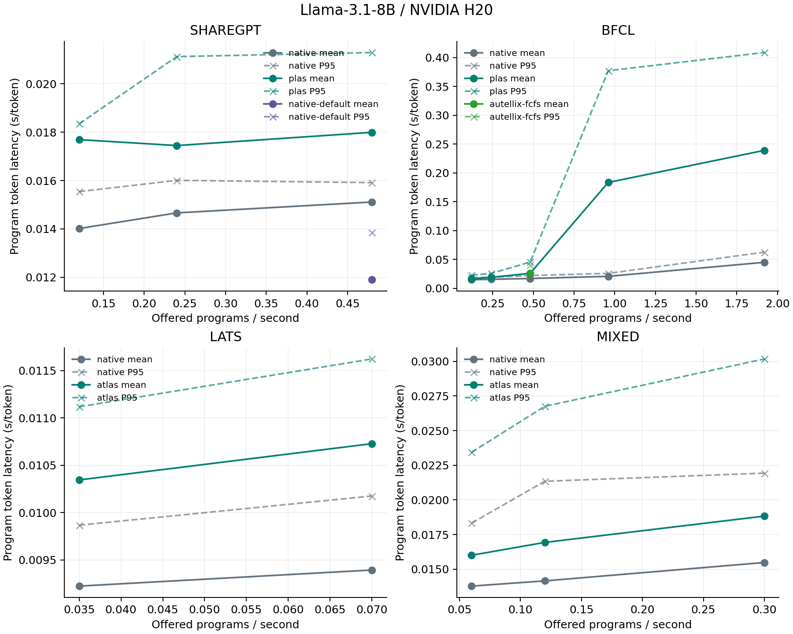

# Autellix 论文复现尝试 · H20

`h20-env-zy-fjr` 用于代码和数据同步，`h20-gpu-zy-fjr` 用于计算。代码位于
`/home/nice/qiuzeyu/stu/fjr/code/autellix`，数据、计划、结果保存在
`/home/nice/qiuzeyu/stu/fjr/data/autellix`，环境为 `fjr` 的 `autellix-sglang`。
SQLite 和进程间通信使用本机 `/tmp/fjr-autellix-*`，运行记录和调度轨迹在结束后保存到共享目录。

实验直接读取共享模型。8B 回放使用 `Meta-Llama-3.1-8B`，大模型配对使用
`Meta-Llama-3.1-70B`，接口验证使用 `Llama-3.2-1B-Instruct`。四个工作负载使用从
P40 迁移的完整 ShareGPT、BFCL、LATS 及其混合集合。Mixed 默认抽取 12 个程序，
每个来源 4 个，混排后按泊松过程到达。每个配对共用程序、到达时间、
GPU、模型、KV 容量和批次上限；候选组使用 PLAS 或 ATLAS。正式配对在 BF16 下使用
SGLang 的 Triton attention，保留 radix 缓存。两组关闭 overlap、CUDA Graph 和
chunked prefill。到达率按 H20 的执行速度设置，结果包含实际积压和排空时间。
汇总记录 SGLang 的累计缓存 token 计数。请求换出后再次接纳会重新累计，因而该计数可
超过原始输入 token 数。[SGLang 0.4.9.post6 缓存计数实现](https://github.com/sgl-project/sglang/blob/v0.4.9.post6/python/sglang/srt/managers/schedule_batch.py)
`--native-default` 增加采用 SGLang 上游默认优化的对照，使用相同模型权重、批次和
KV 上限。`--native-default .48` 只在这个到达率补测。`--device '2;3' --routing-ablation` 在两个单卡副本上，固定调度策略对比
程序亲和性、最少调用数和轮询。多卡单副本使用 `--device '2,3'`。上述卡号为命令示例。
`--fcfs-control .48` 使 Autellix 保留相同钩子、窗口和预备槽，以 FCFS 配对测量调度路径开销。
BFCL 压测的恢复参数为 `--host-kv-gib 32 --host-kv-recompute`，只作用于 Autellix，
主机缓存满时复用 radix 前缀并重算剩余 KV。

下面的命令在 H20 上执行，`gpu` 使用本次分配且空闲的物理卡号。

```bash
source /home/nice/qiuzeyu/stu/fjr/tools/activate.sh
conda activate autellix-sglang
cd /home/nice/qiuzeyu/stu/fjr/code/autellix
export PYTHONPATH="$PWD${PYTHONPATH:+:$PYTHONPATH}"
export HF_HUB_OFFLINE=1 TRANSFORMERS_OFFLINE=1
export TMPDIR="$(mktemp -d /tmp/fjr-autellix-XXXXXX)"
data=/home/nice/qiuzeyu/stu/fjr/data/autellix
model=/data-hdd/opt/models/llama3.1/Meta-Llama-3.1-8B
python scripts/run_h20_paper.py sharegpt --model "$model" --datasets "$data/datasets" \
  --run-dir "$data/runs/h20-sharegpt" --device "$gpu"
```

长任务用 `fjr-autellix-*` 命名的 tmux 会话运行。接口回归启动的 HTTP 服务会随测试退出，
每次配对结束后关闭引擎。结果保存后，通过 `nvidia-smi` 核对任务进程是否已释放 GPU。

论文第 6 节按程序级秒/token 对照可承载的程序到达率，另报 P95 和 P99。结果汇总记录
这三项，并记录实际程序完成率、输出 token/s、到达阶段积压和排空时间。8B 使用单张
H20，70B 在本实验使用流水线并行，论文使用 4 张 A100。论文的主要对照包括 vLLM
0.6.1、启用分块 prefill 和前缀缓存的 vLLM-opt，以及 MLFQ。
[Autellix 论文，第 6 节](https://arxiv.org/html/2502.13965v1#S6)

## 回放输入核对

| 工作负载 | 程序池 | 平均调用数 / 论文 | 平均输出 token/调用 / 论文 | 最长完整上下文 |
| --- | ---: | ---: | ---: | ---: |
| ShareGPT | 128 | 6.10 / 6.66 | 283.97 / 277 | 23,688 |
| BFCL v3 | 64 | 10.77 / 10.75 | 46.39 / 34.14 | 12,482 |
| LATS | 6 | 320.00 / 159.70 | 75.79 / 72.60 | 4,417 |

固定提示包含此前轮次和工具上下文。以最长直接父调用的共同前缀作参考，三个程序池的
平均新增输入分别为 313、693、1717 token/调用。实际 GPU prefill 还取决于 radix
保留的前缀。LATS 采用 30 次搜索迭代和并行扩展，现有样本的程序深度和平均输入都更大。
Mixed 按程序等量抽取，LATS 在模型调用和生成 token 中仍占较高比重。
输入来源与采集配置见[原始工作负载](paper-workload-experiment.md)。

## GPU 功能验收

节点 H20-2 装有 8 张 NVIDIA H20，每张可见 97,871 MiB，CUDA 算力 9.0，驱动
570.133.20。推理环境使用 Python 3.10、PyTorch 2.7.1+cu126 和 SGLang 0.4.9.post6。
8B 单卡配对使用当时空闲的 2、3、7 号卡，各配对在同一张卡上顺序执行。

| 检查 | H20 结果 |
| --- | --- |
| 单卡回归 | 152 项，148 通过，4 项需要 vLLM 或额外 GPU 的测试跳过 |
| KV 往返 | 17,408 token、64 个 K/V buffer，共 2.125 GiB，逐项一致；临时显存峰值 16 MiB |
| 接纳、换出和恢复 | K=0 与 K=1 各换出 15 次，恢复生成与连续生成一致 |
| 主机 KV 满后的重算 | 两个 K 配置各触发 15 次重算，输出一致，会话回收 |
| HTTP 与会话 | Llama-3.2-1B-Instruct 返回 `The capital of France is Paris.`，流式与普通响应、服务历史继承、会话清理通过 |

单卡验收使用 GPU 2，退出后该卡显存为 0 MiB。环境包 `decord 0.6.0` 的内部
wheel 标签为 `cp36`，Python 3.10 上实测可以导入；验收日志保留 `pip check`、
导入输出和完整依赖列表。

代码、固定回放与历史 P40 证据包在 `fjr` 的项目目录内。72 个迁移文件的大小和
SHA-256 已核对，记录位于 `data/autellix/import/migration-verification.json`。
模型直接从 `/data-hdd/opt/models` 读取。

持久盘的 `data/autellix/runs/` 保存 34 次已完成的性能测量和对应计划。回放命令自动使用
`--resume`，按配置、模型、版本和轨迹哈希匹配已完成的测量。[机器可读汇总](results/h20-20261119.json)

## 论文机制与实现

| 机制 | 实现入口与核对 |
| --- | --- |
| PLAS、ATLAS、MLFQ | `autellix/runtime/policy.py` 以实际模型服务时间更新程序历史，按多级 FIFO 队列执行降级和防饥饿；在线 ATLAS 使用论文算法 1 的最长路径标量 |
| N 步与 K 个预备请求 | `autellix/runtime/window.py` 管理窗口和补位；H20 轨迹记录 `schedule_window`、`continue_plan` 和逐步执行 |
| GPU 调度 | `integrations/sglang/scheduler.py` 在 SGLang 的 GPU 调度进程中控制请求接纳、运行批次和 KV 锁；CUDA event 计入模型执行时间 |
| KV 交换 | `integrations/sglang/swap.py` 逐请求执行分块 gather/copy/scatter；论文的跨请求专用 CUDA 聚合交换仍待实现 |
| 多引擎和会话 | `autellix/runtime/engine.py` 管理每副本进程、异步结果和程序亲和性；短输入优先选择请求最少的副本，长输入沿用程序所在副本 |
| 论文实验 | 覆盖完整 ShareGPT、BFCL、LATS、Mixed、同到达率配对和程序级 SLO 曲线；论文的 Falcon-180B 和大规模离线批量曲线仍待补齐 |

## 已测的单卡配对

下表以同资源、同 Triton 配置的原生 SGLang 为基准。响应和秒/token 越低越好，
输出吞吐越高越好。



| 工作负载与到达率（程序/秒） | 策略 | 平均程序响应 | 论文秒/token | 输出吞吐 |
| --- | --- | ---: | ---: | ---: |
| ShareGPT 0.12 | PLAS | +10.31% | +26.21% | −3.60% |
| ShareGPT 0.24 | PLAS | +14.57% | +18.99% | −6.65% |
| ShareGPT 0.48 | PLAS | +15.36% | +19.06% | −7.80% |
| BFCL 0.12 | PLAS | +11.54% | +12.10% | −0.07% |
| BFCL 0.24 | PLAS | +19.32% | +21.35% | −0.08% |
| BFCL 0.48 | PLAS | +46.96% | +52.22% | −1.33% |
| BFCL 0.48 | Autellix FCFS | +46.04% | +49.70% | −1.21% |
| BFCL 0.96 | PLAS，32 GiB + 重算 | +541.67% | +780.23% | −56.07% |
| BFCL 1.92 | PLAS，32 GiB + 重算 | +339.38% | +429.37% | −55.53% |
| LATS 0.035 | ATLAS | +12.10% | +12.17% | −7.45% |
| LATS 0.07 | ATLAS | +14.16% | +14.22% | −10.22% |
| Mixed 0.06 | ATLAS | +10.76% | +16.15% | −5.68% |
| Mixed 0.12 | ATLAS | +11.73% | +19.61% | −7.89% |
| Mixed 0.30 | ATLAS | +11.59% | +21.65% | −8.43% |

在 ShareGPT 0.48 的补测中，上游默认 SGLang 为 17.65 秒、369.46 输出 token/s，
匹配 Triton 的原生组为 25.00 秒、281.43 token/s，PLAS 为 28.84 秒、259.49 token/s。
PLAS 相对上游默认 SGLang 的平均响应增加 63.37%，吞吐下降 29.76%。

BFCL 在 0.48 程序/秒时，原生、Autellix FCFS 和 PLAS 的平均程序响应依次为
9.62、14.04、14.13 秒。原生在到达窗口内完成 46/48 个程序，PLAS 只换出 3 次，
5890 个 GPU 批次有 739 次窗口决策。FCFS 仍承担接纳钩子、每步计时、状态记录和
预填充与解码混合。该对照定位了共用执行路径的成本，PLAS 的排序在这个到达率下
只使平均响应用时额外增加约 0.09 秒。

BFCL 在 0.96 程序/秒时，原生和 PLAS 在到达窗口分别完成 36 和 2 个程序，排空用时
13.29 和 107.95 秒。在平均程序级延迟目标 0.025 秒/token 下，原生 SGLang 和
PLAS 的最高实测到达率分别为 0.96 和 0.24 程序/秒。
1.92 程序/秒的原生组为 20.71 秒、344.75 token/s，PLAS 为 90.97 秒、153.29
token/s。原 16 GiB 主机 KV 配置触到预算后退出，复跑使用同一 GPU 和输入轨迹，保留
已完成的原生结果。第一次中断日志保存在 `logs/autellix/h20-bfcl-stress-16gib.log`。
0.96 和 1.92 程序/秒分别产生 792 和 1016 次完整 KV 往返，以及 26 和 30 次
主机缓存满后的重算。高负载下的主要增量来自频繁的抢占恢复。

LATS 在 0.07 程序/秒时有 58 次预备请求接纳和 44 次窗口内补位，实际执行了 N/K
机制。约 78% 的调用进入最后两级队列，且发生 54 次换出，重排与搬运增加了成本。
当前 LATS 搜索样本比论文更深，Mixed 的固定样本中 LATS 占 4/12 个程序、约 95%
的调用和 93% 的输出 token。

论文用统一的程序级秒/token 比较可承载的到达率，基础 vLLM 对照没有前缀缓存。
H20 配对使用已经有 radix 前缀缓存的 SGLang。把 H20 上的模型执行和调度开销分开后，
优先优化 GPU 调度热路径：把状态写入集中到窗口边界和调用完成，合并 CUDA 计时同步，
并把同批被抢占请求的 KV 聚合传输。测量时同时保留原生、Autellix FCFS 和 PLAS/ATLAS。
[Autellix 论文，第 6 节](https://arxiv.org/html/2502.13965v1#S6)

## 双卡模型与副本验证

两个独立的 Llama-3.2-1B-Instruct 副本已通过短输入负载分流、长输入程序亲和和取消清理。
双卡流水线的初次验收定位到 SGLang 固定版本的 Llama 共享词嵌入装载：最后一阶段需要从
模型的输入嵌入权重初始化输出头。原 P40 的装载逻辑已移入公共流水线路径，供原生 SGLang
和 Autellix 共用。70B 模型的输入嵌入和输出头分别存储。

2026-11-19 在 H20 0、1 号卡重新运行 Llama-3.2-1B-Instruct 双级流水线验收，耗时
40.73 秒。80 次 KV 换出均完成恢复，恢复后的贪心输出与连续生成一致，服务历史继承、
两级调度轨迹一致性及 2 次取消后的会话清理均通过。两张卡在验收退出后均为 0 MiB。

| 70B，BFCL 12 程序、0.48 程序/秒 | 原生 SGLang | PLAS | 变化 |
| --- | ---: | ---: | ---: |
| 平均程序响应（秒） | 109.20 | 172.98 | +58.42% |
| 平均程序级秒/token | 0.16125 | 0.28158 | +74.63% |
| 输出 token/s | 46.15 | 35.27 | −23.56% |
| GPU 3 / 7 峰值显存（MiB） | 87,599 / 86,247 | 88,835 / 87,857 | |

两张 H20 各承担 40 层，使用 BF16、每个流水线阶段 65,536 个 KV token 槽、总批次
上限 8。PLAS 记录到 173 次换出并全部恢复。该组结束后，两张卡回到 0 MiB。
8B 和 70B 的均值按各自配对解读，
两组使用的程序数、并行方式和 KV 配置不同。

### 双副本路由

两张 H20 各运行一个 8B 副本，对同一批 12 个 ShareGPT 程序回放，提交速率为每秒
0.96 个程序。

| 调度与路由 | 平均程序响应（秒） | 输出 token/s |
| --- | ---: | ---: |
| 原生 SGLang | 28.21 | 148.00 |
| PLAS，程序亲和性 | 29.64 | 141.96 |
| PLAS，最少调用数 | 29.79 | 140.46 |
| PLAS，轮询 | 30.61 | 136.61 |

程序亲和性是三种 PLAS 路由中最快的一组，比轮询多输出 3.91% 的 token/s。
相对原生 SGLang，程序亲和性组的平均响应增加 5.05%，吞吐下降 4.08%。
