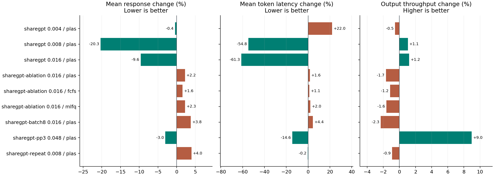

# Autellix 论文复现尝试：原始工作负载与 SGLang 对照

本轮围绕 [Autellix v1 §6](https://arxiv.org/html/2502.13965v1) 的实验方法，
使用完整程序、Poisson 到达和程序级 token 延迟，比较现有 PLAS/ATLAS 与原生
SGLang 调度。ShareGPT 在旧实例的三张 P40 上完成；BFCL、LATS 和 Mixed
在迁移后的两张 P40 上继续。每个配对点的两种策略使用同一张物理卡。

## 数据与工作流

| 工作负载 | 来源与处理 |
| --- | --- |
| ShareGPT | 原始 94,145 个片段合并为 50,142 个完整对话；按整段上下文筛选，不裁剪回答长度；从 128 个程序的固定池中按程序采样 |
| BFCL v3 | 论文发表前的官方提交 `8bf675cc5f92e99971ba1f6bbb15bcf1d1d2eb1c`，2025-02-12；采集 64 个 `multi_turn_base` 任务，使用函数定义和官方状态式工具模拟器 |
| LATS | 官方提交 `853d81614607dd27433faf17c7b0a7d660f95d22`，2024-07-30；运行官方树搜索和提示模板，使用 HotpotQA 训练集问题及配套文档 |
| Mixed | 在三个工作负载类别中等概率选择，再在对应类别中抽取完整程序 |

BFCL 采集直接调用固定版本 `LlamaFCHandler._format_prompt` 和函数定义预处理，
保留 JSON 工具调用及工具返回后的继续生成。温度为 0.001，每次最多生成 4096
token，并受 32768 上下文约束。官方循环在工具步数超过 20 时停止，采集器相应使用
每轮最多 21 次调用。另有 `prepare_bfcl_replay.py` 用官方参考调用执行工具，生成
64 个任务、365 次调用的参考轨迹，供数据准备检查。

采集完成后，用同一固定版本的 `multi_turn_checker` 检查各轮工具状态与返回结果，
并执行 `multi_turn_irrelevance_checker`。官方参考动作的 64 个任务自检全部通过；
实际模型采集的正确率单独汇总，性能回放保留采集到的全部程序。

LATS 采集使用 30 次迭代、5 个扩展样本、1 个评价样本、温度 1.0、每次最多
100 个输出 token，保留官方深度限制、UCT、rollout、评价和反思。每个五样本组
并发提交，组间保留执行依赖。Search/Lookup 在 HotpotQA 随题提供的文档上运行，
Finish 按原始答案判断；采集使用本地 Llama，提示长短版本按服务模型的 tokenizer
选择。搜索树耗尽时结束，单程序调用预算为 400。采集清单记录每个程序的结束原因。

ShareGPT 固定参考对话历史；BFCL/LATS 固定实际采集的输入、输出长度和依赖关系，
然后分别回放两种调度。后续提示使用固定历史，实际生成文本差异不会改变下一次调用
的工作量。性能回放使用温度 0，并按采集长度生成；工具任务正确率取实际采集结果。
调度器在程序到达、调用依赖满足时才接收请求。

数据与代码来源：[ShareGPT](https://huggingface.co/datasets/anon8231489123/ShareGPT_Vicuna_unfiltered)、
[BFCL 固定版本](https://github.com/ShishirPatil/gorilla/tree/8bf675cc5f92e99971ba1f6bbb15bcf1d1d2eb1c/berkeley-function-call-leaderboard)、
[LATS 固定版本](https://github.com/andyz245/LanguageAgentTreeSearch/tree/853d81614607dd27433faf17c7b0a7d660f95d22)、
[HotpotQA 固定版本](https://huggingface.co/datasets/hotpotqa/hotpot_qa/tree/1908d6afbbead072334abe2965f91bd2709910ab)。

## 配对设置

- 模型：Llama-3.1-8B-Instruct，FP16；每个引擎使用一张 P40。
- 主实验：B=4、context=32768、KV 容量 32768 token、静态显存比例 0.9。
- 两组均使用 radix 缓存、P40 PyTorch 算子，关闭 overlap 和 chunked prefill。
- 原生组运行 SGLang 自身调度；PLAS/ATLAS 使用 N=8、K=1、β=8。
- 时间片为 0.64、1.28、2.56、5.12、10.24、20.48、40.96 秒；
  历史分箱边界为 0、20.48、40.96、81.92、163.84、327.68、655.36、∞ 秒。
- 每组重启引擎并预热；比较输入 trace、逐调用长度、模型、软件版本和资源参数。
- 旧实例三张卡同时承担 ShareGPT 独立实验：GPU 0 的 ECC 开启，GPU 1/2 关闭。
  新实例的两张 P40 均开启 ECC，GPU 0 运行 BFCL，GPU 1 运行 LATS/Mixed，配对时不换卡。
- BFCL/Mixed 设置 `autellix_mlp_chunk_size=512`，按 token 分块计算稠密 MLP；
  两种策略使用相同分块参数。LATS 已开始的配对保留原参数。

论文要求各策略使用相同最大 batch size；P40 上主实验固定 B=4，另外进行 B=8
对照。论文的硬件为 A100，模型还包括 70B 和 180B；本轮复现其 8B 模型系列、
工作负载与程序级测量方法。P40 的时间尺度、KV 预算和后端算子按上述配置固定。

## 当前源码核对

本轮核对全部 124 个 Python/启动脚本，服务器与本地源码 SHA256 全部一致，见
[源码清单](results/p40-current-source-inventory.json)。本地 148 项回归中 140 项通过、
8 项按运行条件跳过；服务器 141 项通过、7 项跳过。

| 论文机制 | 当前实现与验证 |
| --- | --- |
| PLAS/ATLAS 与程序表 | `autellix/runtime/policy.py` 实现累计服务、在线最长路径标量、FIFO 分箱、时间片降级与等待/服务比提升；调用完成时更新程序历史 |
| N 步窗口与 K 个预备请求 | `runtime/window.py` 冻结窗口队列，提前完成由已驻留预备请求补位；真实 GPU 抢占、恢复、继承及 K=0/1 接纳检查已通过 |
| 实际 GPU batch 与 KV | `integrations/sglang/scheduler.py` 控制 SGLang GPU scheduler 的接纳、running batch 和缓存锁；`swap.py` 完成锁页内存换出/恢复，2.125 GiB KV 往返逐项相等 |
| 跨引擎路由 | `runtime/engine.py` 按 2048-token 阈值分流短请求，长请求保持程序亲和；此前双副本路由、取消和三卡路由对照已完成 |
| 同一模型跨多卡 | `sglang/pipeline.py` 将首阶段策略输入、GPU 执行时间及 KV 操作传到各阶段；PP=3 实际生成、取消、恢复和逐阶段调度记录一致性已通过 |
| 原始工作负载 | ShareGPT 完整对话、固定版本 BFCL 工具执行和 LATS 树搜索均已生成真实轨迹；Mixed 等概率采样三个类别；相同输入与长度用于策略配对 |
| 交换实现差异 | 当前按请求、按层分块使用 PyTorch gather/copy/scatter；论文的跨请求 CUDA 聚合交换内核是下一项实现工作 |
| 硬件与基线差异 | 本轮使用 P40、8B 模型系列与原生 SGLang；论文还有 A100 上的 70B/180B、vLLM/vLLM-opt/MLFQ 多模型曲线 |

## 实验矩阵

| 实验 | 程序数 | 到达率（程序/秒） | GPU | 策略 |
| --- | ---: | --- | --- | --- |
| ShareGPT 主曲线，seed=2026 | 每点 48 | 0.004 / 0.008 / 0.016 | 分别 0 / 1 / 2 | native、PLAS |
| ShareGPT 第二种子，seed=2027 | 24 | 0.008 | 0 | native、PLAS |
| ShareGPT 策略消融，seed=2027 | 8 | 0.016 | 0 | native、PLAS、内部 FCFS、MLFQ |
| ShareGPT B=8，seed=2027 | 8 | 0.016 | 0 | native、PLAS |
| BFCL，seed=2026 | 每点 48 | 0.005 / 0.01 / 0.02 | 新实例 0 | native、PLAS |
| LATS，seed=2026 | 6 | 0.004 | 新实例 1 | native、ATLAS |
| Mixed，seed=2026 | 12 | 0.008 | 新实例 1 | native、ATLAS |
| ShareGPT 三卡共享模型，seed=2026 | 48 | 0.048 | 0、1、2，PP=3 | native、PLAS |

ShareGPT 主曲线每组均为 297 次调用、83,455 个输出 token；三个到达窗口分别
约为 14,614、7,307、3,654 秒。第二种子为 95 次调用、28,324 个输出 token。
这轮将到达窗口延长，并通过单引擎配对消除上一轮两个长程序被分到同一卡的路由变量。

三卡共享模型组使用同一个 Llama-3.1-8B，按 10/11/11 层切分，B=12（每个
pipeline microbatch 为 4）、KV 预算 327680 token、静态显存比例 0.9，attention
分块预算为 16777216 个元素，两组使用相同设置。
该组把三张卡的显存用于同一个模型及其 KV，检验更接近论文大显存条件时的调度效果。
全部单卡工作结束后再运行此组。

主曲线中的两个最长程序分别有 34/48 次调用、15,959/12,171 个输出 token，
合计占全部输出的 33.71%。两者最大提示分别为 20,010/23,466 token，合计
43,476，超过单卡的 32,768 KV 槽位。即使尾部只剩这两个程序，单卡也无法同时
保留它们的完整长上下文；三卡共享模型组用于检验扩大 KV 空间后的表现。

## 指标

同时报告平均/P95/P99 程序响应、论文程序级 token 延迟、输出吞吐、到达期间的
完成程序数、尾部排空时间、按到达顺序分四组的延迟，以及十个时间点的在途程序数。
顺序程序使用程序响应/总输出 token；LATS/Mixed 的论文指标使用关键路径响应/
所有线程的总输出 token。

SLO 表取实测负载点中满足给定平均程序级 token 延迟的最大到达率。到达率、
整段完成速率和包含排空时间的 token/s 分别记录。每个主曲线点对应的 GPU 编号
保留在结果中，第二种子和批大小消融单独汇总。

## 如何对比论文收益

论文摘要中的 4–15× 指同一程序级延迟下可承受的程序到达率；固定一份工作量的
输出 token/s 衡量另一件事。调度可以让短程序更早完成，同时因抢占和交换增加
总运行时间。因此本轮同时列出延迟曲线、SLO 对应到达率和固定工作量吞吐。

论文以 vLLM、vLLM-opt 和 MLFQ 为基线。原始 vLLM 基线没有前缀缓存，论文明确
将重复计算累计历史列为其劣势；本轮原生 SGLang 已开启 radix 缓存。这里比较的是
在已有前缀复用之上加入程序级优先级的收益。

硬件与执行路径也影响交换成本：论文使用 A100 80GB、PCIe 4.0 和专用 CUDA
聚合交换内核；当前 P40 路径使用 PyTorch 算子和按请求、按层的 16 MiB 交换块。
后者解决了大临时张量的显存峰值问题，仍包含多次拷贝与同步。单卡和三卡共享模型
两组分别测量当前小 KV 预算与扩大 KV 预算的表现；三卡组同时改变了 batch 和
pipeline 配置，结果按完整资源配置比较。

## 运行记录

长对话首次触发 KV 换出时，旧实现的整层 `stack` 额外申请 2.13 GiB，超过剩余
显存。现已改为按层、按 token 的 16 MiB 分块传输，换入使用相同方式。
P40 上 17,408 token、64 个 K/V buffer、共 2.125 GiB 的往返逐块相等，
临时 GPU 内存峰值为 16 MiB。失败日志保存在 `paper-suite-swap-oom/`，
中负载 PLAS 配对从头重跑。原生组不经过此换出路径。

重跑至第 258 次调用时，又发现低优先级恢复项的缓存锁占用了高优先级新调用
所需空间。修复后，新调用已有的缓存前缀先被保护，接纳失败时按优先级释放后缀
的临时锁并重新接纳；被延后的调用保留主机 KV。已晋升为活动请求的低优先级
预备项也会让出空间。GPU 小模型测试覆盖 K=0/1、512 个 KV 槽位容纳两条各
300 token 的输入，实际触发换出、恢复和接纳重试，恢复后的生成与连续生成一致。
失败与中断日志保存在 `paper-suite-prefill-capacity/`。

`run_sglang_matrix.py --resume` 校验资源、工作负载、后端版本、已完成策略参数
和输入 trace 后复用已完成项；可调整未运行的到达率与策略参数。
高负载原生 SGLang 的完整结果保留；受影响的 PLAS 项从头重跑。

BFCL 首次原生回放在约 4.5 小时后遇到 MLP 临时张量显存溢出：激活计算申请
500 MiB 时，仅剩约 250 MiB。原生模式也会触发这次溢出。新增稠密 MLP token
分块，保持每个 token 的线性层和激活计算，限制中间张量大小。P40 FP16 检查使用
16,000 token、4096 hidden、14336 intermediate，512-token 分块将临时峰值从
1,845,624,832 降到 190,840,832 字节；最大绝对差 0.0078125，通过 FP16 数值比较。
检查代码为 `scripts/check_mlp_chunks_gpu.py`，结果见
[MLP 分块检查](results/p40-mlp-chunks-20261117.json)。失败日志与原计划保存在
`paper-suite/pre-bfcl-mlp-oom/`，BFCL 两种策略均使用分块后从头运行。

BFCL 原计划的最低到达率 0.02/s 已积压：48 个程序在 2922.9 秒内到达，
到达结束时约 3 个程序完成。后续曲线改为 0.005/0.01/0.02/s；程序、采样种子、
533 次调用和 27,118 个输出 token 保持配对一致。各点到达窗口分别为
11,691.5/5,845.8/2,922.9 秒，继续记录到达期间完成量和排空时间。

2026-11-17，ShareGPT 单卡与三卡实验全部完成：16 次策略运行、9 个配对比较。
BFCL/LATS 首次采集在模型加载前因默认 K=1 与原生模式冲突退出，采集器现已显式
使用 K=0。BFCL 的 64 个程序已采集完成，三个到达率的配对正在运行；LATS/Mixed
继续执行。原始输出写入
`/mnt/masfiles/autellix/runs/paper-suite/`。首次启动发现 SQLite 状态位于网络持久盘，
在正式配对完成前停止并重启；启动日志保存在 `paper-suite-networkfs-start/`，
正式运行使用指向本机磁盘的 `autellix/tmp/`。

## 已完成的 ShareGPT 结果

变化相对原生 SGLang；响应与秒/token 越低越好，吞吐越高越好。
逐程序结果、配对检查与分位数见[机器可读汇总](results/paper-sharegpt-summary.json)。

| 实验 | 平均程序响应变化 | 平均秒/token 变化 | 输出吞吐变化 |
| --- | ---: | ---: | ---: |
| 48 程序，0.004/s | −0.42% | +22.04% | −0.54% |
| 48 程序，0.008/s | −20.32% | −54.75% | +1.05% |
| 48 程序，0.016/s | −9.60% | −61.25% | +1.21% |
| 第二种子，24 程序，0.008/s | +3.96% | −0.24% | −0.90% |
| 8 程序消融，PLAS | +2.24% | +1.64% | −1.67% |
| 同一消融，内部 FCFS | +1.59% | +1.13% | −1.16% |
| 同一消融，MLFQ | +2.28% | +2.03% | −1.61% |
| 同一 8 程序，B=8、PLAS | +3.77% | +4.43% | −2.31% |
| 三卡共享 8B，48 程序，0.048/s | −3.02% | −14.56% | +8.96% |

中负载原生/PLAS 平均程序响应为 1372.38/1093.45 秒，36/48 个程序更早完成；
高负载为 1412.41/1276.85 秒，30 个程序在到达窗口内完成，原生为 29 个。
高负载平均秒/token 为 1.8339/0.7106，中位数为 0.8060/0.7820，P95 为
1.9556/1.1419。平均值收益大于中位数收益，部分来自极短输出程序的等待减少：
1-token 程序从 31.88 秒降至约 1 秒，7-token 程序的归一化延迟也显著下降。
仅作敏感性分析，排除总输出不超过 7 token 的两个程序后，高负载平均秒/token
仍下降 19.49%；主表保留全部程序。

低负载的 +22.04% 主要由同一个 1-token 程序从 0.210 秒变为 5.289 秒造成。
该组总吞吐下降 0.54%，平均程序响应下降 0.42%，说明平均归一化指标对短输出
的等待很敏感。排除上述两个极短输出程序，平均秒/token 下降 2.29%。

负收益仍存在，原因与实验条件有关。8 程序消融的最高输入只有 2240 token，
PLAS/FCFS/MLFQ 均没有发生 KV 换出；内部 FCFS 也比原生慢约 1.16%，表明
程序表、执行计时及调度钩子的基础成本已经能解释这类低竞争负载的部分差距。
PLAS 相对原生额外损失约半个百分点吞吐，优先级重排在这份短轨迹中没有抵消
控制成本。把 B 从 4 扩至 8 后，PLAS 的服务时间加权 batch 仅从 3.11 增至
3.14，没有形成更多并发工作，吞吐反而更低。

中、高负载分别发生 399/432 次换出、129/162 次预备补位，程序级优先级已经
减少排队；主曲线中 104–117 次新调用仍进入最低服务队列，长程序的历史区分度
在尾部降低。高负载两组排空时间仍为约 8416/8271 秒，长对话尾部主导总吞吐，
因此秒/token 的改善没有转化成同幅度 token/s 改善。

三卡共享模型的原生/PLAS 吞吐为 9.263/10.093 token/s，平均程序响应为
855.99/830.11 秒，平均秒/token 为 0.5488/0.4689，P95 为 0.7610/0.6563。
两组全部 297 次调用的 trace、输入输出长度、模型、版本和资源参数配对一致。
PLAS 的逐卡显存峰值为 22895/24411/24343 MiB，合计各卡峰值为 69.97 GiB；
这些峰值发生时刻可能不同。三张卡平均利用率为 94.73%/94.68%/95.16%。

大 KV 配置仍发生 304 次换出、累计 424604 token；单卡高负载为 432 次、
1349650 token。扩大 KV 能减少搬运，但程序优先级切换仍触发主机保存与恢复。
首阶段 trace 的服务时间加权微批次大小为 2.06，23504/41185 个执行批次只有
一个请求；长程序尾部使 B=12 的总体容量无法持续填满。三卡组的到达率也从
0.016/s 改为 0.048/s，因此两种资源配置的差异同时包含负载、batch、KV 与 PP。

下一步独立扫描服务分箱上界与最低队列时间片；
减少窗口内数据库和 trace 发布，并实现跨请求聚合交换。低竞争场景用内部 FCFS
测量控制成本，高竞争场景继续检查短程序完成时间与长程序 P95，使用相同 trace
配对比较。第二种子仍有响应 +3.96% 的结果，说明收益也依赖程序组成。

目录组织和重跑入口见[服务器目录](server-layout.md)。

## BFCL 采集与任务评测

64 个官方 `multi_turn_base` 任务产生 689 次模型调用、589 次工具执行、31965 个
输出 token。每程序平均 10.7656 次调用，最长 26 次；论文报告的平均调用数为
10.75。平均每调用输出 46.39 token，完整输入 7364.13 token；按相邻输入的公共
前缀计算，前缀以外平均 693.14 token。完整输入包含累计会话与工具定义。

57 个流程自然结束，7 个触达每轮 21 步上限。工具执行中有 235 条结果以官方
`Error during execution:` 开头，采集保留这些返回及后续模型调用。

官方 checker 判定 **2/64 个任务通过，成功率 3.125%**；40 个为工具状态不符，
22 个为执行返回结果不符。官方参考动作的 64 项自检全部通过。本轮 Llama-3.1-8B
的工具任务完成率较低，后续性能回放保留全部实际轨迹，并同时报告任务结果和调度
结果。采集统计和逐任务判定见[BFCL 结果](results/bfcl-capture-20261117.json)。

checker 的失败详情包含官方 `Directory` 对象，JSON 导出使用该对象的文本表示。
在服务器和本地独立重跑 checker，64 项判定与失败详情完全一致；模型输入、生成
结果和工具执行记录保持不变。对应启动日志保存在 `pre-bfcl-checker-export/`。

## LATS 采集与任务结果

HotpotQA 训练集的 6 个固定问题已完成官方 30 轮搜索，产生 1920 次模型调用和
145519 个输出 token。每程序平均 320 次调用，平均每调用输出 75.79 token，
完整输入平均 2398.78 token。6 个程序均自然完成搜索，未触达 400 次调用预算。
逐问题结果和采集哈希见[LATS 结果](results/lats-capture-20261117.json)。

这 6 个问题的答案均未通过原答案匹配。原始搜索找到正确终结节点时会提前返回；
本轮搜索均执行完整迭代，形成了更长的程序。论文报告的 LATS 平均为 159.7 次
调用、72.6 个输出 token/调用。本轮使用本地 Llama 和随题文档执行 Search/Lookup，
保留官方树搜索、提示模板、五样本并发组及组间依赖。调度回放使用这批实际生成
轨迹，原生 SGLang 与 ATLAS 接收相同的输入、生成长度和依赖关系。
