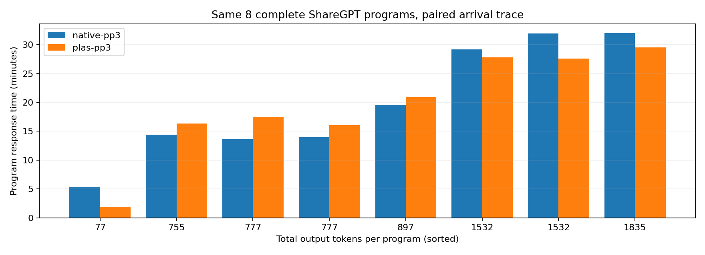
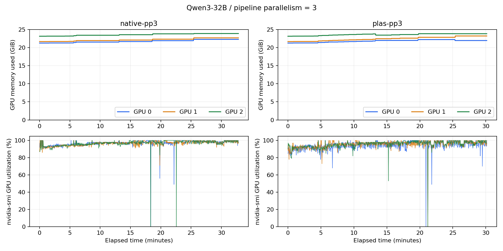
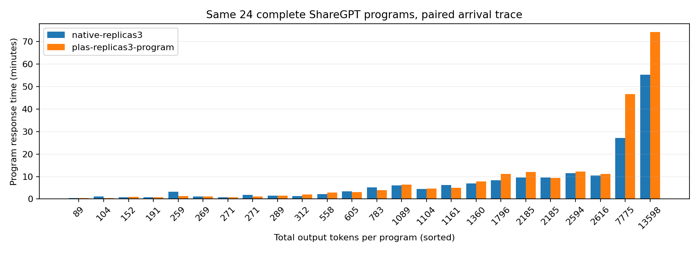
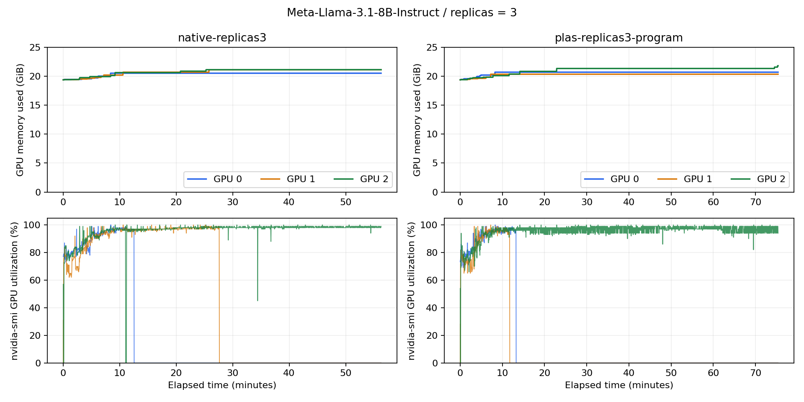
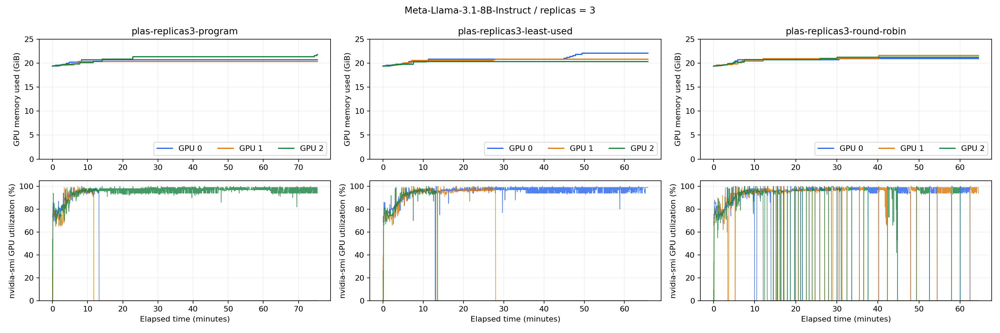

# Autellix 论文复现尝试：三张 P40 的大模型调度

本轮把一个 Qwen3-32B 模型拆到三张 P40 上执行，并与相同资源配置的原生
SGLang 调度对照。论文依据仍为 [Autellix v1](https://arxiv.org/html/2502.13965v1)。

## 三卡资源与模型

| 项目 | 配置 |
| --- | --- |
| GPU | 3×Tesla P40，compute capability 6.1 |
| 可见显存 | GPU 0：23040 MiB；GPU 1/2：各 24576 MiB；合计 70.5 GiB |
| ECC | GPU 0 启用，GPU 1/2 关闭；所有对照保持相同设置 |
| 系统 | Ubuntu 22.04，驱动 550.120，18 核 CPU 配额，72 GiB RAM |
| 推理环境 | Python 3.10.12，Torch 2.7.1+cu126，SGLang 0.4.9.post6，Transformers 4.54.0 |
| 大模型 | Qwen3-32B，FP16，64 层，PP=3，按 20/22/22 层拆分 |
| 性能回放上下文 / KV | context=4096，max_total_tokens=16384，mem_fraction_static=0.96 |
| 活动容量 | B=6，三个微批次各 2 个活动请求 |
| Autellix | N=8，每个微批次 K=1，时间片 ×64，服务历史区间 ×1024 |
| 主机交换空间 | 每个阶段 2 GiB |

可见显存是三个独立地址空间。`--device-groups '0,1,2'` 配合 `pp_size=3`
使模型层与对应 KV 分布在三卡；`--devices 0,1,2` 则加载三个完整副本。
Qwen3-32B 的 64 个 Query heads 和 8 个 KV heads 不适合三路 TP，
因此使用流水线并行。层数分配也考虑了 GPU 0 的显存较小。

正式回放的原生组同时显存峰值为 70437 MiB（68.79 GiB），Autellix 组为
70597 MiB（68.94 GiB），后者占可见显存的 97.79%。Autellix 各卡峰值为
22727、23747、24393 MiB，逐卡平均 GPU 利用率为 94.34%、95.46%、95.51%。
显存主体为模型权重与 KV；执行中还使用临时 tensor、通信和分配器空间。
GPU 之间通过 PCIe 通信，拓扑为 PHB/PIX。利用率来自 `nvidia-smi`，其中包含
通信活动；各阶段实际执行另外用 CUDA events 计时。
完整版本、CPU 配额、拓扑、模型结构及 tokenizer/config 哈希见
[环境记录](results/three-gpu-environment.json)。模型配置文件中的权重类型为 BF16，
加载时显式转为 P40 使用的 FP16。

## 代码实现

1. `ReplicaConfig` 校验每组 GPU 数与 TP×PP 一致，避免多张可见卡仅加载单卡模型。
2. SGLang 适配开放 PP，保留原生多微批次流水线循环。
3. 首阶段独占程序表更新；其数据库读取结果和策略时间随微批次传到后续阶段。
   各阶段得到一致的优先级、时间片和接纳顺序，各自保存与恢复本阶段的 KV。
4. 每个微批次维护独立的 N 步窗口和预备请求，其他微批次的预备 KV 保持归属。
   本微批次空间不足时可等待其他微批次释放容量。
5. GPU 服务时间在每个阶段的模型 forward 中计量，沿流水线累加，
   随输出 token 返回首阶段。程序历史使用三个阶段的累计 GPU 服务秒数。
6. 固定版本 Llama 的 tied embedding 在 PP 下缺少末阶段输出 head，
   已修复为在末阶段加载同一 embedding 权重。原生对照共用此模型兼容修正。
7. 结果保存逐卡显存与利用率、设备组、每次调用实际副本、逐阶段调度记录。
8. Autellix 接纳预算按当前 N 步窗口计算。此前沿用的整段最大输出长度估算会
   提前拒绝本来能运行的请求，并导致额外换出；现在只调整 KV 估算，实际生成
   长度和停止条件保持请求中的设置。
9. 取消遍历所有在途流水线批次，包含尚未合并到 running batch 的 prefill。
   固定版本原生取消只检查当前/上一批，第三个微批次可能被遗漏；现在由各阶段
   标记目标请求，并沿原有完成路径回收 KV、返回取消统计。

该 PP 扩展将论文的调度窗口应用到流水线微批次；PLAS/ATLAS 的程序历史仍由
整个模型副本统一维护。专用跨请求 CUDA 交换内核、BFCL 工具执行和 LATS 搜索
工作流是后续实现项，当前 GPU 实验使用 ShareGPT 完整对话回放。

## 论文内容的实现状态

| 论文内容 | 当前源码与验证方式 |
| --- | --- |
| 程序表、PLAS、在线 ATLAS | `autellix/runtime/policy.py`；按完成调用更新累计服务或最长已观察路径，真实 GPU 回归检查后续调用继承 |
| 多级 FIFO、时间片、防饥饿 | 同一 RuntimeScheduler；CPU 策略回归与真实 batch trace |
| N 步选择、K 个预备请求 | `runtime/window.py` 和 SGLang scheduler/reserve；真实生成记录窗口、预备、补位与交换 |
| GPU/CPU KV 搬运 | `sglang/swap.py`；各层打包后整块传输，当前逐请求使用 PyTorch gather/stack/scatter |
| 多引擎与 2048-token 路由 | `runtime/engine.py`；三独立进程、会话历史、短请求 least-used 与长请求亲和；增加 RR/least-used 配对实验 |
| 多卡模型执行 | 新增 SGLang PP 扩展，实际运行 32B；首阶段统一调度输入，各阶段独立 KV、累计 GPU 计时 |
| ShareGPT | 原始分片合并完整会话、参考历史与长度、按程序采样、Poisson 到达 |
| BFCL/LATS/Mixed | 模拟器有对应统计负载，真实 runtime 支持带提示和依赖的工作流；真实工具循环和 MCTS 数据接入待完成 |
| 论文专用 CUDA 交换内核 | 待实现；当前是 PyTorch 打包传输，SGLang 尚未跨请求合并交换 |
| 论文全部硬件和模型条件 | 本轮覆盖 P40、Llama-3.1-8B 和 Qwen3-32B；A100、70B/180B、论文全部负载曲线尚未运行 |

[源码清单](results/three-gpu-source-inventory.json)保留各 Python/启动脚本的路径、行数和统一为 LF 换行后的 SHA256；早期单卡的逐模块核对见
[源码与实验设计检查](experiment-design-review.md)。当前项目是 Autellix 论文复现尝试，
主要调度机制已进入真实 GPU 执行路径，实验覆盖情况按上表记录。

## 已完成的功能验证

| 验证 | 结果 |
| --- | --- |
| Qwen3-14B 原生 PP=3 | 六个并发生成全部完成 |
| Qwen3-14B Autellix PP=3 | 六个并发生成全部完成，5 次真实换出/换入 |
| Qwen3-32B Autellix PP=3 | 六个并发生成全部完成，5 次换出/换入，6 次预备请求保留/恢复，1 次补位 |
| 强制抢占回归 | PP=3，80 次换出与 80 次恢复；中断生成与连续生成文本一致 |
| 阶段一致性 | 三个阶段的 batch、执行时间、换出、换入和完成记录逐条一致 |
| 程序状态 | 后续调用继承已执行服务；三个在 GPU 上执行的调用取消成功，程序表清空 |
| 本地 CPU 回归 | 128 项通过，8 项按 GPU/后端环境条件跳过 |
| 服务器 CPU 回归 | 129 项通过，7 项按 GPU 环境条件跳过 |
| 最终三卡回归 | 65.14 秒通过：80 对换出/恢复、9 次完成、3 次取消，恢复文本与三阶段记录一致 |
| 最终 32B HTTP 验收 | 六路短请求、历史继承、流式一致性、两个并发 3920-token 输入全部完成；负载归零、会话清空 |

功能探针的 14B/32B 时长用于检查生成与回收；正式性能结论采用下述配对回放。

## 实验设计

原始 ShareGPT 按 ID 中的消息偏移合并分片，得到完整会话；用 Qwen3 tokenizer
重新构造输入。保留整个对话、参考回答长度和顺序依赖，固定参考历史，设置
`ignore_eos=true`。按 4096 context 筛选整个会话后建立 32 个程序的候选池，
种子 100 抽样 8 个程序，共 30 次调用、8182 个输出 token；Poisson 到达率
为每秒 0.08 个程序。参数见[完整计划](results/three-gpu-plan.json)，数据来源、
筛选 ID 和回放哈希见[数据清单](results/three-gpu-workload.json)。

原生组使用 SGLang 自身的调度与 KV 管理；Autellix 组使用 PLAS，适配顺序调用
程序。双方使用相同模型、精度、分层、请求输入、到达轨迹、B 和 KV 容量。
原生组 K=0，Autellix 每个微批次 K=1；预备请求占用同一 KV 总预算。
双方共用 P40 的 PyTorch attention、采样、norm 与 rotary 路径。

同时记录平均程序响应、P95、程序响应/输出 token 和总输出吞吐。
论文的吞吐收益是在相同程序延迟下比较不同到达率；本轮单个负载点报告
各指标的实际变化，后续可沿同一计划扩展到达率和种子。

另设三副本实验，使用论文中的 Llama-3.1-8B-Instruct、context=32768 和完整
ShareGPT 对话池，24 个程序、137 次调用、41616 个输出 token，到达率 0.24/s。
三卡总活动容量为 12，程序数设为其两倍，以形成实际排队；到达窗口为 116.686 秒。
其中两个最长程序为 38/28 次调用、13598/7775 个输出 token，合计占输出量 51.36%。
结果同时保留到达窗口与排空耗时，便于检查长尾对整段吞吐的影响。
一组比较相同程序路由下的原生 SGLang 与 PLAS；另外固定 PLAS，分别使用
program、least-used、round-robin 路由，检查论文 §6.4 的数据亲和收益。
参数见[三副本计划](results/three-replica-plan.json)。

## Qwen3-32B 三卡对照结果

两组均完成 8 个程序、30 次调用和 8182 个输出 token。

| 指标 | 原生 SGLang | Autellix PLAS | 变化 |
| --- | ---: | ---: | ---: |
| 全部完成耗时（秒） | 1970.15 | 1810.18 | −8.12% |
| 输出吞吐（token/s） | 4.153 | 4.520 | +8.84% |
| 平均程序响应（秒） | 1201.31 | 1182.76 | −1.54% |
| P95 程序响应（秒） | 1921.07 | 1772.80 | −7.72% |
| 平均程序响应/输出 token（秒/token） | 1.52527 | 1.23919 | −18.76% |
| 平均调用首 token 延迟（秒） | 38.80 | 4.10 | −89.44% |

这组的三个主要指标均改善。收益分布并不平均：77-token 短程序从 320.79 秒降到
114.37 秒；三个 1532/1835-token 长程序分别快 4.64%、13.60%、7.72%；中间四个
程序慢 6.67%–28.24%。按输出长度归一化的指标更重视短程序，因此改善幅度大于
不归一化的平均响应。8 个样本的 P95/P99 均为最大响应，原始结果保留全部单程序值。



Autellix 真实工作负载产生 5241 个执行批次、658 个调度窗口、60 次换出和 60 次恢复，
累计换出 26164 个 token 的 KV，62 次预备保留、60 次缓存恢复、3 次补位。
三个阶段的 10641 条 batch/执行/交换/完成记录逐条相同（含预热）；GPU 服务计时为三个阶段
累计 3781.60 秒。这里的累计服务时间可以大于墙钟时间，因为三张卡同时工作。



两组输入和到达轨迹 SHA256 相同，每次调用生成 token 数相同，30 次生成中 21 次文本
哈希相同。实验使用固定参考历史，文本差异不会改变后续输入或工作量。抢占恢复的数据
正确性另由同一 FP32 模型的中断/连续贪心生成回归检验。
该结果为种子 100、到达率 0.08/s 的一次配对运行，完整数字见
[32B 结果 JSON](results/three-gpu-32b.json)。

这轮将单卡改成 PP=3，同时修正 N 步 KV 接纳并实现微批次预备请求。观测到首 token
等待明显缩短、短程序更早结束、整个 trace 更早排空。各项改动的独立贡献还需要消融；
下一轮可固定此配置，分别比较 K=0/1、N=2/4/8 及不同时间片，并增加程序数与种子。

## Llama-3.1-8B 三副本对照结果

两组均完成 24 个完整程序、137 次调用、41616 个输出 token，使用相同 program
路由规则和到达 trace。两组中 110/137 次输出文本哈希一致，逐调用输出长度一致。

| 指标 | 原生 SGLang | Autellix PLAS + program | 变化 |
| --- | ---: | ---: | ---: |
| 全部完成耗时（秒） | 3377.88 | 4522.72 | +33.89% |
| 输出吞吐（token/s） | 12.320 | 9.202 | −25.31% |
| 平均程序响应（秒） | 446.62 | 552.85 | +23.79% |
| P95 程序响应（秒） | 1624.96 | 2800.66 | +72.35% |
| P99 程序响应（秒） | 3314.91 | 4459.75 | +34.54% |
| 平均程序响应/输出 token（秒/token） | 0.31276 | 0.29449 | −5.84% |
| 平均调用首 token 延迟（秒） | 6.576 | 1.965 | −70.11% |

这组的吞吐、平均响应和长尾回退，归一化程序延迟改善。24 个程序中 11 个更快，
例如 104-token 程序从 69.65 秒降到 25.95 秒，259-token 程序从 191.53 秒降到
78.38 秒；两个最长程序则明显变慢。



**最集中的损失来自两个长程序的放置。** 7775-token 程序从 1624.96 秒增加到
2800.66 秒，13598-token 程序从 3314.91 秒增加到 4459.75 秒。二者增加的
2320.54 秒占全部程序响应增量 2549.62 秒的 91.02%。原生组的长请求分别固定在
GPU 1/2，PLAS 组则都固定到 GPU 2；这是实际完成时序改变后，least-used 初次选择
和后续亲和绑定产生的放置差异。相同路由规则不会自动得到相同的副本分布。

PLAS 三卡分别生成 8540、8468、24608 个 token，GPU 2 占 59.13%；逐卡平均
利用率为 15.92%、13.60%、95.63%。原生组分别生成 7951、14264、19401 个 token。
PLAS 组前两张卡约在前 13 分钟结束工作，GPU 2 持续到约 75 分钟。
两种配置均加载并使用三张卡，后期空闲源于程序顺序依赖和固定亲和位置。



真实 PLAS trace 包含 2498 个窗口、19942 个执行批次、39 对换出/恢复、17847 个
换出 token、59 次预备保留和 21 次补位；实际送入模型的 input tensor 共 84343 个
token，包含 prefill 与逐步 decode。它用于和后续不同路由的相同工作量比较重算量。
完整结果保留在[三副本结果 JSON](results/three-replica.json)。

本组是调度器与动态路由共同作用的端到端结果。要进一步分离原因，应固定原生组
的逐调用副本分配重跑 PLAS，再与动态 program 路由比较；这样可以区分本地调度
开销和副本放置导致的延迟。

### 路由对照

固定 PLAS 参数、输入与到达 trace，只改变路由：

| 路由 | 全部完成秒数 | token/s | 平均程序响应秒 | 程序响应/输出 token | 实际模型输入 token |
| --- | ---: | ---: | ---: | ---: | ---: |
| program | 4522.72 | 9.202 | 552.85 | 0.29449 | 84343 |
| least-used | 3949.54 | 10.537 | 474.58 | 0.28051 | 94561 |
| round-robin | 3870.23 | 10.753 | 500.06 | 0.30719 | 139710 |

least-used 相对 program 吞吐提高 14.51%、平均响应缩短 14.16%，模型输入量增加
12.11%。两条长链在重叠阶段分别运行于 GPU 0/1，减少争用的收益超过了额外
prefill 的代价；累计 GPU 服务时间从 5932.49 秒增加到 6307.80 秒，但墙钟时间缩短。
这说明本样本中，最小化重算量与最小化端到端响应并不是同一目标。

相对原生 SGLang，least-used 的平均响应增加 6.26%、吞吐下降 14.47%，归一化
程序延迟下降 10.31%。7775-token 程序恢复到 1646.24 秒，接近原生 1624.96 秒；
13598-token 程序为 3886.56 秒，仍高于原生 3314.91 秒。后者主要在 GPU 0 执行，
原生组主要在 GPU 2，下一步的固定映射消融也用于分离卡位和调度开销。

round-robin 将 137 次调用分配为 46/46/45 次，逐卡平均利用率为
57.86%/52.54%/44.56%。实际模型输入量比 program 多 65.65%，换出增加到 56 次、
30996 个 token。相对原生，其吞吐下降 12.72%、平均响应增加 11.97%，归一化
程序延迟下降 1.78%。相比 least-used，整段吞吐略高，但平均与归一化程序延迟更差。
三种路由中，least-used 的平均和归一化程序延迟最低，round-robin 最早排空，
program 的模型输入量最低。



[三种路由的逐程序响应图](results/three-routing-programs.png)展示各长度程序的收益分布。

三种 PLAS 路由都生成相同的 41616 个 token。模型输入量包含纯 prefill、decode
以及混合批次的全部 input tensor；因此可以比较额外输入工作量。原生组没有安装
这项逐批次记录，JSON 对应值为 null。

## 与论文条件的差异，以及此前负收益的原因

三副本原生基线暴露了本轮负载点的一个重要特征：程序到达持续 116.69 秒，全部
完成需要 3377.88 秒，之后 3261.20 秒用于排空。在到达阶段只有 4/24 个程序完成。
三个 GPU 的平均利用率为 20.11%、45.52%、95.98%，各完成 28、48、61 次调用；
后期只剩一个 38 轮程序，只有其所在副本继续执行。这里的低利用率来自顺序依赖和
有限 trace 的长尾，三个副本均已实际加载并承担请求。

因此本轮 0.24 程序/s 是强突发过载点。按平均 1734 输出 token/程序和整段
12.32 token/s 计算，整段完成速率约为 0.0071 程序/s。后续负载曲线应先从
0.005、0.01、0.02 程序/s 附近校准，并增加程序数、延长持续到达窗口，观察排队
是否持续增长，再比较同一程序 token 延迟下的可承受到达率。

论文使用 A100、vLLM 0.6.1 和 Llama-3.1-8B/70B、Falcon-180B；本轮保留论文
8B 模型作为副本实验，并增加能放进三张 P40 的 FP16 32B 模型。程序采样、Poisson
到达、完整会话和程序级 token 延迟沿用论文方法，硬件、推理内核、模型并行方式和
实验规模按当前服务器配置设置。

论文的 4–15 倍主要结果比较的是相同程序 token 延迟下可承受的到达率，主基线没有
前缀缓存；优化基线启用了前缀缓存、多步与分块 prefill。当前对照的两组均使用
SGLang radix 缓存，且本轮先测固定到达率。因此要复跑论文吞吐曲线，需要在多个
到达率上记录延迟并比较同一 SLO 的交点。

此前单卡负收益中，已有代码和实验能定位到以下问题：

- 旧 ShareGPT 按分片运行，并截短输出，削弱了长短程序之间的差异；已恢复完整对话
  与参考长度，修正重复 BOS，并固定参考历史。
- 0.01 秒起步的时间片和 0.64 秒上限的历史分箱与 P40 的执行时间不匹配，导致
  高频交换、大量后续调用集中到末队列。历史消融中，放大时间尺度把短回放换出数
  从 129 降到 13；8B 扩大历史区间后，归一化延迟改善而平均响应仍略变差。
- 整段最大输出的 KV 接纳估算与 N 步调度窗口不一致。本轮已修正，回归直接调用
  固定版本的 PrefillAdder，覆盖正常 EOS 和 `ignore_eos` 两种请求。
- 调度并不直接加速模型算子。排队很少时，策略、计时、数据库发布和交换增加的
  开销难以被等待时间节省抵消；排队时，不同长度程序也会有不同的收益与损失。
- 当前交换仍使用逐请求 PyTorch 打包，且窗口内继续逐 token 发布元数据。
  专用交换内核、跨请求批量传输和窗口级发布是下一步降低固定开销的实现方向。

本次 32B 获得正收益，8B 三副本的 program 路由在长尾上回退。下一步按以下顺序修改和检验：

1. **固定副本分配做消融。** 保存原生组逐调用的 engine ID，让 PLAS 重放同一映射，
   分离本地调度与动态放置的影响；同时控制 GPU 0 的 ECC 和卡间差异。
2. **给亲和路由增加迁移条件。** 亲和副本有排队、其他副本空闲时，将预计等待与
   前缀重算成本一起考虑。保留论文原 program 路由为基线，分别记录迁移次数、
   实际模型输入 token、GPU 利用率与长尾响应。
3. **测持续到达曲线。** 先校准 0.005/0.01/0.02 程序/s 附近的负载，增加程序数
   和随机种子，比较相同程序 token 延迟下的可承受到达率。
4. **降低固定控制和交换开销。** 将窗口内元数据发布合并，增加跨请求 KV 打包传输，
   再分别消融 N、K、时间片和历史区间。记录单程序分布、平均响应、归一化延迟、
   吞吐与交换量。

## vLLM 检查

另建独立 vLLM 0.6.1 / Torch 2.4.0+cu121 / Transformers 4.44.2 环境。
导入成功；执行预编译 CUDA 算子时，P40 返回
`no kernel image is available for execution on the device`。
[vLLM 0.6.1 安装文档](https://docs.vllm.ai/en/v0.6.1/getting_started/installation.html)
列出的最低 GPU compute capability 为 7.0。当前使用已完成三卡生成与交换验证的
SGLang 路径；vLLM 的 P40 运行需要另行编译和适配其算子。

## 复跑与部署

正式性能回放使用 KV=16384。服务验收中，约 3500-token 的长 prefill 在 GPU 0
申请 256 MiB attention 临时张量时显存不足；短请求、历史继承和流式输出已正常完成。
服务配置现改为 KV=8192、`max_prefill_tokens=4096`，保留 FP16 32B、PP=3、
context=4096 和 B=6。减小静态 KV 池为 prefill 留出临时空间，
单批 prefill 上限控制多个长输入合批时的峰值。原性能计划和结果继续保留 KV=16384。
两个约 3900-token 输入并发时，末阶段仍触发 256 MiB score 张量分配失败，
因此新增 `autellix_attention_score_elements` 参数。最终服务设为 16777216，
每个 FP32 score 块上限为 64 MiB；保持绝对位置的 causal mask 和全部 query 计算。
该参数同时支持原生基线与 Autellix，默认值仍为性能实验所用的 67108864。
长输入继续执行到 MLP 后，末阶段还出现 192 MiB 临时分配不足。最终服务将层数改为
**20/23/21**，把一层移到中间卡，为末阶段输出 head 与 MLP 留出空间。
性能回放仍对应 **20/22/22、KV=16384、score 预算 67108864**；
服务配置为 **20/23/21、KV=8192、prefill 上限 4096、score 预算 16777216**。

最终 HTTP 验收通过，完整流程耗时 193.69 秒。六个并发请求均回答 Paris，历史会话
回答 `2 plus 3 is 5`，流式与非流式内容相同；两个并发长输入各 3920 token，
分别生成 14/17 token 的摘要。服务同时显存峰值 **70791 MiB（69.13 GiB）**，
占可见显存 **98.06%**；各卡峰值 22685/24263/23843 MiB。结束后 `/health`
返回 `loads=[0]`、`device_groups=["0,1,2"]`，`/sessions` 为空。
检查结果与实际进程参数见[最终验收记录](results/three-gpu-validation.json)。

在服务器项目目录和 SGLang 环境中运行：

```bash
export SGLANG_PP_LAYER_PARTITION=20,22,22
export HF_HUB_OFFLINE=1 TRANSFORMERS_OFFLINE=1 TORCHDYNAMO_DISABLE=1
export OMP_NUM_THREADS=4 TOKENIZERS_PARALLELISM=false PYTHONPATH=.
python scripts/run_sglang_matrix.py \
  --plan docs/results/three-gpu-plan.json \
  --output outputs/three-gpu-comparison.json

bash scripts/serve_p40_three_gpu.sh
```

正式回放结果位于服务器 `/mnt/masfiles/autellix/runs/three-gpu`。
服务使用新的本地 `/tmp/autellix-pp3-*` 状态目录，模型、代码和实验归档保存在
`/mnt/masfiles` 持久盘。

服务地址为服务器本机 `http://127.0.0.1:8000`。在本地建立 SSH 转发后，可使用
`InferenceClient("http://127.0.0.1:8000")` 调用：

```bash
ssh -p 46644 -L 8000:127.0.0.1:8000 root@cn-north-b.ssh.damodel.com
```

## 原始结果归档

六个已完成 trial、原始工作负载、调度 trace、版本清单、测试与显存定位日志保存在：

`/mnt/masfiles/autellix/runs/three-gpu-results-20261116.tar.gz`

归档已下载到本地 `outputs/three-gpu/`，逐文件校验通过；大小和 SHA256 见
[归档记录](results/three-gpu-archive.json)。解压后的 `three-gpu/manifest.json`
列出每个文件的大小与哈希，`traces/` 保存原临时目录中的完整调度记录。

从归档重新生成汇总：

```bash
mkdir -p outputs/archived
tar -xzf /mnt/masfiles/autellix/runs/three-gpu-results-20261116.tar.gz -C outputs/archived
python scripts/summarize_three_gpu.py \
  --input outputs/archived/three-gpu/comparison-32b.json \
  --input outputs/archived/three-gpu/comparison-replicas.json \
  --trace-root outputs/archived/three-gpu/traces \
  --output outputs/archived/summary.json
```
